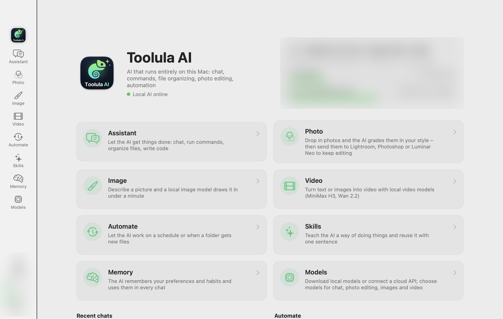
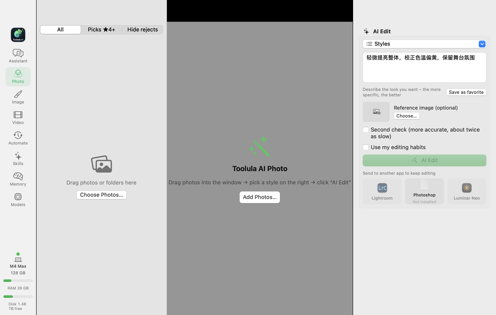
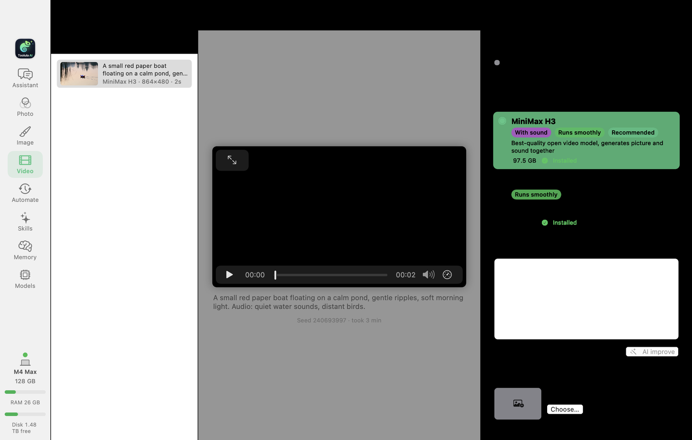
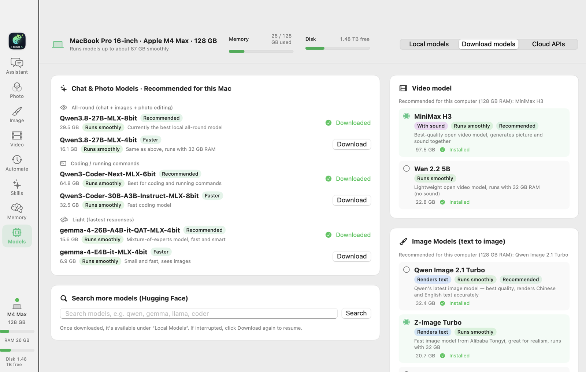

# Leonix

A local-first AI assistant for the Mac. You can run it entirely on your own machine with local models, or connect cloud models when you want them.

Leonix was previously called Toolula AI. Updating keeps all your data, which stays in `~/Toolula`.

Leonix is a native SwiftUI app for **macOS 14 or later on Apple Silicon** (M1 and newer). Its interface is available in English, Simplified and Traditional Chinese, Japanese, Korean, German, French, Spanish, Portuguese and Russian.



| Photo editing | Video |
|---|---|
|  |  |



## Features

- **Assistant**: chat with local or cloud models.
  - Tools for files, the browser, documents and MCP servers.
  - Long-term memory.
  - Voice input.
  - Quick Ask from anywhere.
- **Photo editing**: AI culling and grading for RAW and JPEG.
  - Global adjustments plus local adjustments for face, skin, eyes, lips, teeth, subject, sky and background.
  - Portrait retouching built on face landmarks: texture-preserving skin smoothing, blemish removal (moles are kept), under-eye softening, even skin tone, dodge & burn, and brighter eyes, whiter teeth and richer lip color.
  - AI recognition streams its answer, so the scene and the first suggested look appear within seconds.
  - Landscape tools: luminosity masks (highlights / shadows), vegetation, auto straighten, HDR merge of bracketed shots, and matching a whole shoot to one reference photo.
  - Optional components you can add on the Models page: a semantic segmentation model (Apple's DETR, 85 MB) for water, mountain and building areas, and the AI eraser model (LaMa, 216 MB). Neither is bundled with the app or stored in this repository.
  - Before/after comparison.
  - Batch editing by scene.
- **Lightroom Classic integration**: send edits to Lightroom as RAW plus XMP, with editable AI masks. The preview is calibrated to match Lightroom's rendering. A companion Lightroom plugin is bundled.
- **Image generation**: through a local ComfyUI.
- **Video**: create short videos from images.
- **Automation**: scheduled and repeatable tasks.
- **Skills**: reusable skills, including skills imported from GitHub.
- **Models**: manage local MLX models and connect providers:
  - Local servers: LM Studio and Ollama.
  - Cloud APIs: OpenAI, Anthropic Claude, Google Gemini, DeepSeek, OpenRouter, Groq and Mistral.
- **System integration**: Finder Services menu ("Summarize / Edit / Make a Video with Leonix", "Ask Leonix"), Shortcuts actions, a desktop widget and a command palette (⌘K).

## Download and install

1. Download `Leonix-<version>.dmg` from the [latest release](../../releases/latest).
2. Open the DMG and drag **Leonix** into **Applications**.
3. Open the app for the first time. It is not notarized by Apple, so macOS will block it:
   - Open **System Settings → Privacy & Security**.
   - Scroll down and click **Open Anyway** next to "Leonix".
   - On macOS 14 you can also right-click the app and choose **Open**.

   If macOS says the app is "damaged", run this once in Terminal:
   ```
   xattr -dr com.apple.quarantine "/Applications/Leonix.app"
   ```
4. The setup wizard guides you through choosing models. Local models need a lot of memory: 16 GB of RAM is the minimum, and 32 GB or more is recommended. Cloud providers need an API key.

Optional:
- [LM Studio](https://lmstudio.ai) or [Ollama](https://ollama.com) for local models.
- ComfyUI for image generation.
- Adobe Lightroom Classic for the Lightroom features.

## Build from source

```
./build_app.sh             # release build -> build/Leonix.app (warns about missing translations)
./build_app.sh --selftest  # self-test build -> build/selftest/Leonix.app (adds --snapshot and other switches, see Sources/ToolulaAI/SelfTest.swift)
scripts/install.sh         # install the release build to /Applications and re-register it
scripts/make_dmg.sh        # package build/Leonix.app as build/Leonix-<version>.dmg
```

The build is signed with a local certificate called "Toolula Local Signing", which is kept in the Keychain and is not part of this repository. A stable signature means that macOS permissions such as Accessibility survive rebuilds. If the certificate is missing, the app is signed ad hoc.

## Tests

```
swift test                       # unit tests (Tests/ToolulaAITests)
scripts/regress.sh --quick       # regression: screenshot every page and run the features that need no large model, pixel-compared with the previous run
scripts/regress.sh               # full regression (adds chat with tools, compaction, warm-up, photo analysis, Quick Ask)
scripts/check_translations.py    # find untranslated UI strings (whitelist: Localization/untranslated_whitelist.txt)
scripts/check_a11y.py            # find icon-only buttons without an accessibilityLabel
```

Regression results go to `regress-results/<timestamp>/summary.md`, which is not committed.

## Project layout

- `Sources/ToolulaAI/`: the app.
- `Widget/`: the WidgetKit extension.
- `Tests/`: the unit tests.
- The Lightroom plugin lives next to this repository in `../AIPhotoEdit.lrplugin`, which is a separate git repository. `build_app.sh` copies its `ai_edit.py`, `*.lua` and `desktop_process.py` into the app.
- User data is stored in `~/Toolula/` (the folder keeps its name from before the rename), outside the repository: chats, data, models, engines, exports and logs, each in its own subfolder.
- Translations live in `Localization/translations.json`. Each key is the original Chinese UI string. `Localization/make_strings.py` generates the `.lproj` folders from it.

## License

Leonix is licensed under the [Apache License 2.0](LICENSE). The Leonix name, logos and app icons are not covered by the license, and neither is the Lightroom plugin, which lives in a separate repository.

The engines and models Leonix downloads at run time (llama.cpp, ComfyUI, the chat, image and video models …) keep their own licenses. Some models limit commercial use: Qwen-Image 2.1 is for non-commercial use only, and MiniMax-H3 has its own community license. [NOTICE](NOTICE) lists them all.
